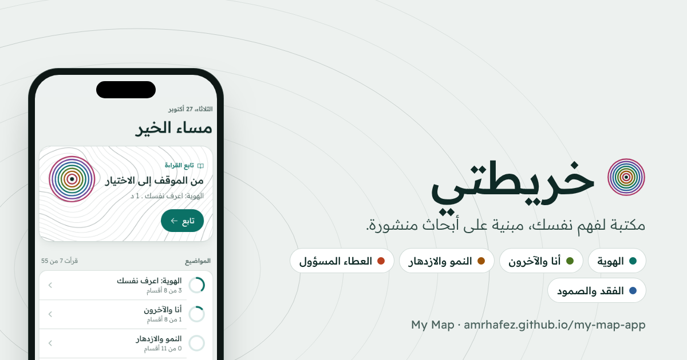

# خريطتي | My Map

**خريطتي** تطبيق لفهم الذات بالعربية والإنجليزية. يبدأ بسؤال بسيط: من أين تحب أن تبدأ؟ ثم يقدّم لك قراءة مفصّلة على مقاسك.

**افتح التطبيق:** https://amrhafez.github.io/my-map-app/

## ثلاث طرق للبدء
- **ساعدني أجد نقطة بدايتي:** ثمانية أسئلة قصيرة تقترح مسارًا يناسبك، مع مسار ثانٍ قد يفيدك.
- **سأختار مساري بنفسي:** اعرف نفسك، أو المعطاء المسؤول، أو أمرّ بفقد.
- **أريد القراءة فقط:** مكتبة كاملة مرتبة حسب الموضوع، بلا أسئلة أو تمارين شخصية.

## المسارات
| المسار | لمن؟ |
|---|---|
| اعرف نفسك | لكل من يريد أن يفهم قيمه واحتياجاته ومشاعره وعلاقاته ونموّه |
| المعطاء المسؤول | لمن يعطي الجميع وينسى نفسه: الدوائر الثلاث، والحدود اللطيفة، والتعافي |
| أمرّ بفقد | لمن يحزن أو يساند حزينًا: مراحل الفقد، والنماذج الحديثة، والعناية بالنفس |

يمكن تغيير المسار أو إعادة أسئلة البداية في أي وقت من «ملفي».

## الخصوصية
كل الإجابات والبطاقات وتقدّم القراءة تُحفظ في متصفح الزائر فقط، ولا تُرسل إلى أي مكان.

## التصميم
شاشات التطبيق وصورة المعاينة موجودة في [ملف Figma](https://www.figma.com/design/4YdV1h8VzZ75xVY8y88SM7) (صفحة Thumbnail للصورة 1200x630).

## تنبيه
محتوى تعليمي للتأمل الذاتي مبني على أبحاث منشورة ومراجعه داخل التطبيق، وليس أداة تشخيص نفسي ولا بديلًا عن مختص.

